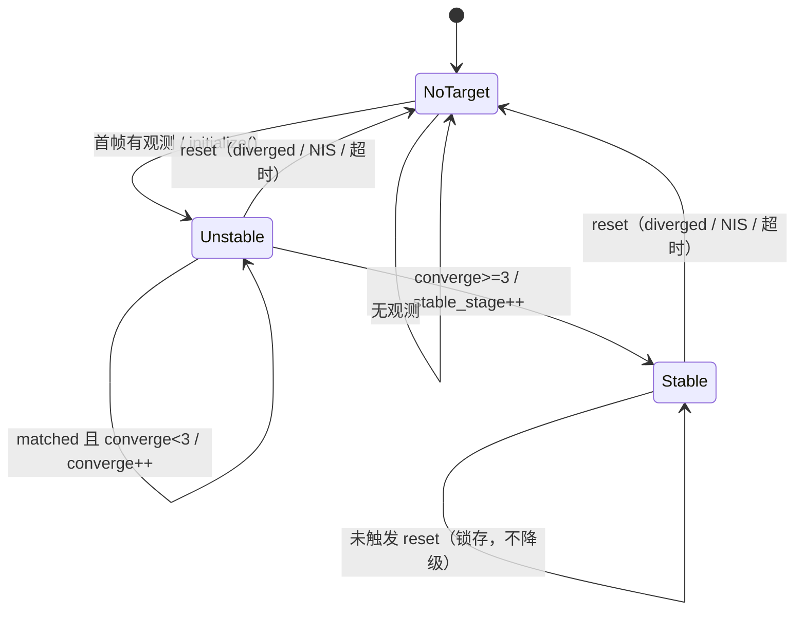

# 状态机 StateMachine 讲解（EKF 收敛 / 发散 / 丢失）

> 文件：`tracker/src/EKFEstimator.cpp`（`update()` 尾部 `:372-385` + `reset()`/`initialize()`/`diverged()`）。
> 输出：`TrackingState`（`NoTarget/Stable/Unstable`），直接写进串口 `crc` 字段。
> 配置：`config/ekf.yaml`（`converge_frames/reset_lost_s/nis_*` 等）。

## 1. 一段话讲解

状态机不是多态互跳的 FSM，而是**「单向收敛 + 3 路 reset 回退」**：`NoTarget → Unstable → Stable` 只能前进，`Stable` 一旦进入就**锁存**（不会退回 `Unstable`），唯一的回退是 3 条 reset 通道（物理越界 / NIS 发散 / 超时）把它**直接打回 `NoTarget`**。开火判据只看一条：`state == Stable`。

## 2. 状态（3 个）+ 与通信协议的绑定

| 值 | 枚举 | 语义 | 来源 |
|---|---|---|---|
| 0 | `NoTarget` | 无目标：未初始化 或 刚 reset | 通信协议规定 |
| 1 | `Stable` | 已收敛并锁存（`converged_frames_ >= 3`） | 通信协议规定 |
| 2 | `Unstable` | 有目标、正在积累收敛帧数 | 通信协议规定 |

**硬性要求（来自 sanlanx/RMVtraining `通信结构体.md`）**：这三个值直接写进 64 字节帧的 `crc` 字段（offset 61），且 `fire_allowance` 必须与 `crc=1` 绑定——"只有稳定状态才能进一步判断是否允许开火"。落点：

- `AutoAimTypes.hpp:20` — `enum class TrackingState { NoTarget=0, Stable=1, Unstable=2 }`（注释：数值直接对应历史通信字段 crc）。
- `Communication.hpp:38` — `uint16_t crc; // 视觉 -> MCU：EKF 状态 0/1/2，不是校验和`。
- `AppSupport.cpp:95` — `message.fire_allowance = (prediction.state == Stable) ? 1 : 0;`

> 结论：**状态的值/语义/开火绑定是任务规定的；状态机内部怎么流转（单向收敛、锁存、reset 通道、收敛帧数）是自己设计的。**

## 3. 触发条件（guard，时间驱动）

没有外部离散事件，每帧 `update()` 就是一次 tick，所有触发都是每帧现算的布尔条件：

| 触发条件 | 代码位置 | 作用 |
|---|---|---|
| 首帧有观测 `!observations.empty()` | `:305` | 进入 Unstable（initialize） |
| `matched`（本帧 ≥1 板关联上） | `:346 / :373` | 推进收敛计数、刷新时间戳 |
| `converged_frames_ >= converge_frames(3)` | `:383` | 进入 Stable |
| `diverged()`（半径/角速度越界） | `:367` | reset |
| `nis_fail_frames_ >= nis_fail_frames(3)` | `:370` | reset |
| `lost_s > reset_lost_s(0.20s)` | `:379` | reset |

## 4. 转移（单向收敛）

| 当前 | 条件 | 下一状态 | 动作 |
|---|---|---|---|
| NoTarget | 首帧有观测 | Unstable | `initialize()` |
| NoTarget | 无观测 | NoTarget | — |
| Unstable | `converged_frames_` 未满 3 且 matched | Unstable | `converged_frames_++` |
| Unstable | `converged_frames_ >= 3` | **Stable** | `stable_stage_++` |
| Stable | 未触发 reset | Stable | （锁存，不掉级） |
| Unstable / Stable | `diverged()` | NoTarget | `reset()` |
| Unstable / Stable | NIS 连 3 帧超阈 | NoTarget | `reset()` |
| Unstable / Stable | `lost_s > 0.2s` | NoTarget | `reset()` |

**核心性质**：`converged_frames_` 只增不减（reset 才清）。所以 `Stable` 不会退回 `Unstable`，短暂丢帧（<0.2s）也不掉级——这就是"抗短暂遮挡"的来源。

## 5. 动作

| 动作 | 位置 | 做了什么 |
|---|---|---|
| `initialize()` | `:222` | 选近侧板；单板用「板+预设半径」外推中心，双板用「两条法向延长线交点」几何法估中心；填状态（R0/R1=预设，恢复 `saved_dz_`）；设初始协方差 `P_`；`converged_frames_=0` |
| `reset()` | `:52` | **先存物理常数**（`saved_r0_/r1_/dz_`）；清 `converged_frames_/nis_fail_frames_/target_id`；`last_nis_=1e18`（下次 predict 用全量 Q 加速收敛）；`x_/P_` 清零 |
| 每帧 matched | `:373-376` | `last_obs_timestamp_=timestamp`；`converged_frames_++`（封顶 3） |
| 首次进 Stable | `:384` | `stable_stage_++`（纯显示，不参与逻辑） |

## 6. 状态切换示意图

单向收敛流程图（ASCII，可直接贴 PPT）：

```
NoTarget ──(首帧有观测, initialize)──▶ Unstable ──(converge_frames_ 满 3)──▶ Stable（锁存）
   ▲                                        ▲                                  ▲
   │                                        │                                  │
   └──────────(3 条 reset：diverged / NIS×3 / lost>0.2s)───────────────────────┘
```

Mermaid 版（答辩.md / GitHub 可渲染）：



## 7. 答辩要点

1. **单向收敛锁存**：`NoTarget → Unstable → Stable` 只进不退，`Stable` 锁存直到 reset，短遮挡不掉级。
2. **3 路 reset**：物理越界（半径/角速度）、NIS 发散（连 3 帧超 χ² 分位）、超时（0.2s）。
3. **开火只看 `state == Stable`**：几何判据（正对/距离）交给 Planner/火控，状态机只管"现在信不信估计"。
4. **reset 不丢物理常数**：reset 前存半径/高度差，发散→reset 代价小，不会瞎猜半径。
5. **与通信协议绑定**：状态值 0/1/2 就是 `crc` 字段，任务只规定"报哪个值 + 开火挂钩"，内部流转是自研亮点。
